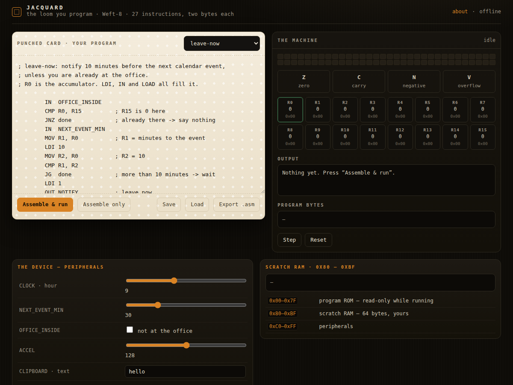

<div align="center">

# Jacquard

<!-- shot:start -->



<!-- shot:end -->

**The loom you program — an 8-bit machine you can hold in your head.**

[](https://drsamonline.github.io/app-jacquard/)
[](https://github.com/drsamonline/app-jacquard/actions/workflows/test.yml)
[](https://github.com/drsamonline/app-jacquard/actions/workflows/build-apps.yml)
[](https://github.com/drsamonline/app-jacquard/releases/latest)
[](LICENSE)
[](#-what-it-refuses-to-do)
[](package.json)

[**Open the loom →**](https://drsamonline.github.io/app-jacquard/) · [Reference card](https://drsamonline.github.io/app-jacquard/play/#card) · [What it refuses](#-what-it-refuses-to-do) · [Tests](#-the-proof)

</div>

---

Automation usually hides behind coloured boxes. Jacquard puts a **real machine** underneath it: a
fictional 8-bit CPU, the **Weft-8**, programmed in assembly, with the clock, the calendar, the clipboard
and the accelerometer exposed as **memory-mapped peripherals**. You read a register, you act on it — and
you can watch every register, flag and byte change while it runs.

The whole app is one page and two files it carries with it. No build step, no framework, no network, no
account.

<div align="center">

```
        IN  OFFICE_INSIDE        ; read the machine's senses
        CMP R0, R15
        JNZ done                 ; already at the office -> say nothing
        IN  NEXT_EVENT_MIN
        CMP R1, R2               ; ten minutes or less?
        JG  done
        OUT NOTIFY               ; leave now
done:   HLT
```

</div>

## Contents

| | |
|---|---|
| [The machine](#-the-machine) | the ISA, the flags, the memory map |
| [What a program looks like](#-what-a-program-looks-like) | `leave-now`, end to end |
| [The proof](#-the-proof) | 118 assertions: 102 for the engine, 16 that drive the page |
| [What it refuses to do](#-what-it-refuses-to-do) | the failure behaviour, asserted not promised |
| [Run it](#-run-it) | from a USB stick, a laptop, a phone |
| [One honest note on the count](#-one-honest-note-on-the-count) | 27 opcodes, not 28 |

## The machine

| | |
|---|---|
| **Registers** | 16 × 8-bit. `R0` is the accumulator — `LDI`, `LOAD` and `IN` all fill it, `MOV` moves it. |
| **Flags** | `Z` zero · `C` carry/borrow · `N` negative · `V` signed overflow |
| **Instructions** | fixed **two bytes**, little-endian: the opcode, then the operand |
| **Operand** | an 8-bit value, address or port — or two registers packed as `a << 4 \| b` |
| **Address space** | 256 bytes: ROM `0x00`–`0x7F`, RAM `0x80`–`0xBF`, peripherals `0xC0`–`0xFF` |
| **Stack** | 16 deep, with overflow and underflow reported rather than crashed |

Because the operand byte carries both registers, `ADD R12, R5` is literally `04 C5`. A program with a
known listing assembles to exactly that listing, byte for byte — which is the first thing the tests assert.

The peripherals are host callbacks, so the machine is testable with no browser at all:

```
CLOCK  0xC0   LAT 0xC1   LON 0xC2   OFFICE_INSIDE 0xC3   NEXT_EVENT_MIN 0xC4
NOTIFY 0xC5   CLIPBOARD 0xC6   ACCEL 0xC7   RNG 0xC8   AUDIO 0xC9   HALT 0xCA
```

## What a program looks like

`leave-now` ships with the app: notify ten minutes before the next calendar event, unless you are already
at the office. It exercises a peripheral read, a comparison, a signed branch and an output — and all four
of its paths are asserted.

```
        IN  OFFICE_INSIDE
        CMP R0, R15          ; R15 is 0 here
        JNZ done             ; already there -> say nothing
        IN  NEXT_EVENT_MIN
        MOV R1, R0           ; R1 = minutes to the event
        LDI 10
        MOV R2, R0           ; R2 = 10
        CMP R1, R2
        JG  done             ; more than 10 minutes -> wait
        LDI 1
        OUT NOTIFY           ; leave now
done:   HLT
```

The page shows you the registers, the four flags, the program bytes, scratch RAM, and a **weave strip**
that lights up the instruction the program counter is standing on.

## The proof

```
node test-node.js          # 102 assertions, no dependencies — the engine
node tests/page-smoke.js   # 16 assertions — the page, driven in jsdom
```

The tests run the **real** engine — `docs/play/weft8.js`, the same file the page loads. Nothing is mocked
except the peripherals, which are callbacks by design.

- the encoding, byte for byte, including `ADD R12,R5` → `04 C5`
- **all 27 opcodes** assembling and running in one program
- **five hand-checked branch traces**, including signed `JL` at `-1` vs `1` and `JG` at `127` vs `-1`,
  where the subtract overflows
- carry, overflow, zero and negative — from `ADD`, `SUB`, `SHL`, `SHR` **and `CMP`'s own borrow**
- `CALL`/`RET` nesting, `PUSH`/`POP` order, the 16-deep overflow and the empty-stack `RET`
- the peripherals, the ROM write refusal, the step limit, an opcode that does not exist
- every refusal in the assembler, with the line number it refuses on
- **the page itself**: that it loads the engine, that its script parses, and that every example it offers
  assembles on the machine it ships

And `tests/page-smoke.js` boots the real page in jsdom, clicks the real buttons and reads the real DOM: run,
step, reset, the weave strip, the device sliders reaching the machine, and a program that does not assemble
being refused instead of run. That test exists because a page bug no engine test could see — `vm.h` where it
should have been `vm.peripherals`, which made **Assemble & run** throw — shipped once and was caught only by
driving the page. jsdom is a **test-only** dependency; the app has none.

**Checked to bite**, not just to pass: rewrite `JL` to test `Z` and two branch traces fail; suppress
`CMP`'s borrow and the carry assertion fails.

## What it refuses to do

| Situation | What happens |
|---|---|
| The program does not assemble | it is **never run**; the error names the line and the reason — an undefined label, `R16`, an immediate of 300, a program past the 128-byte ROM |
| The program loops forever | it stops at the step limit, and the page says it stopped there |
| `RET` with an empty stack | an error, not a crash |
| A write into ROM | refused **and reported**, rather than silently doing nothing |
| Storage is full or unavailable | Save says so, and tells you to export instead; the editor keeps your program |
| No network | nothing changes — there is nothing to fetch. The peripherals are simulated on the device |

## Run it

Open `docs/index.html`. That is the whole app; `web-kit.js` and `weft8.js` sit next to it, so it works
from `file://` and from GitHub Pages.

| Where | How |
|---|---|
| **Browser** | [drsamonline.github.io/app-jacquard](https://drsamonline.github.io/app-jacquard/) |
| **Windows** | the portable EXE on the [rolling release](https://github.com/drsamonline/app-jacquard/releases/latest) |
| **Android** | the signed APK on the same release |
| **Anywhere** | copy the folder; there is nothing to install |

## One honest note on the count

The spec asks for "a program using all **28** opcodes" and then names twenty-seven:
`LDI MOV LOAD STORE ADD SUB AND OR XOR NOT SHL SHR CMP JMP JZ JNZ JG JL CALL RET PUSH POP IN OUT RAND NOP HLT`.
The machine has **27**, and this README says so rather than inventing a twenty-eighth to satisfy a number.

## Licence

**PolyForm Noncommercial 1.0.0** · © 2026 Dr Sohil Momin. Free for any noncommercial purpose; commercial
use needs a licence from the author.

<div align="center"><sub>Built with <a href="https://github.com/drsamonline/web-kit">web-kit</a> · offline, no accounts, no telemetry</sub></div>
